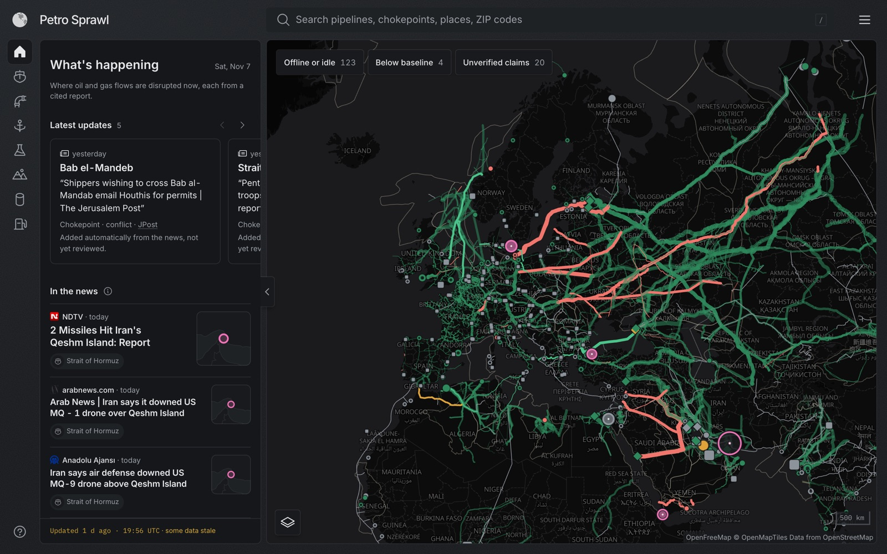
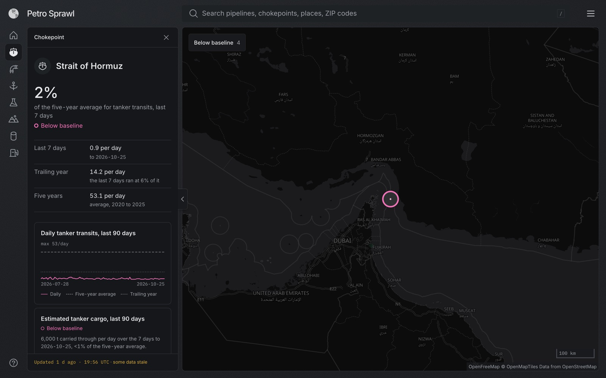
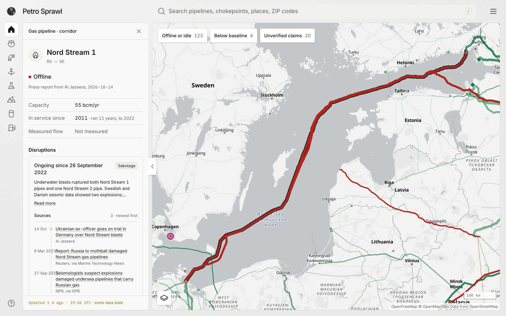
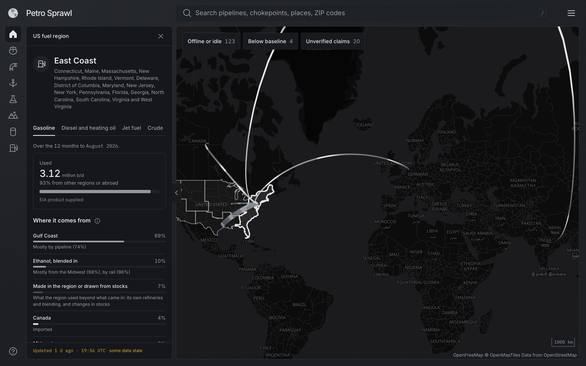

# Petro Sprawl

The energy context behind the headline: where oil and gas flow, where they've stopped, and the source for each.

**[petrosprawl.fyi](https://petrosprawl.fyi)**



Energy flows explain a lot about why governments decide what they decide, why alliances form and why they break. News strips that structure away. Petro Sprawl puts it back on the map: every pipeline, terminal, refinery and chokepoint is a real place, and each one shows three things kept apart on purpose:

- **Capacity:** what it could carry.
- **Status:** what state it's in, as a dated claim with its source. A status that rests only on a dataset's listing says so.
- **Flow:** what it actually carries, where a measured series exists.

## What you can do with it

| | |
| --- | --- |
| **See what's disrupted now** | Home lists the disruptions in effect, newest report first, and the measured changes in the data since last week. |
| **Check a chokepoint** | Daily tanker transits through Hormuz, Bab el-Mandeb, Suez, Malacca and three more, against their trailing year and five-year average. |
| **Open any pipeline** | Status with its evidence, capacity, owners, the disruption timeline and, for EU entry points, metered gas flow against technical capacity. |
| **Look up your fuel** | Type a US ZIP code, city or state to see where your region's gasoline, diesel, jet fuel and crude come from, and which chokepoints sit on the way. The location never leaves your browser. |
| **Compare countries** | Gas in storage against a year earlier, and crude imports by partner country. |
| **Cite what you use** | Every page has its own link and a citation to copy. |
| **Explore the ground** | USGS petroleum provinces, EIA's shale plays with monthly production by formation, and some 6,500 oil and gas fields with their yearly output. |

<table>
  <tr>
    <td width="33%"></td>
    <td width="33%"></td>
    <td width="33%"></td>
  </tr>
  <tr>
    <td>A chokepoint against its own baseline</td>
    <td>A pipeline's status and its sources</td>
    <td>Where a region's gasoline comes from</td>
  </tr>
</table>

## Principles

- **Never invent data.** A value without a source is `unknown`, and the page says so.
- **Evidence, not opinions.** A status is a dated claim with a link. Positive and negative claims age at the same rate.
- **Measured beats claimed.** Where a metered series exists, it sets the status and is shown first.
- **Data age is always visible.** Every figure says when it was fetched, and stale data is flagged.
- **Interpretation stays with the reader.** Facts sit side by side; the app doesn't editorialize.

## How it stays current

There is no database and no backend. Scheduled jobs fetch each source, validate it, and commit static JSON; every commit redeploys the site.

```
Public sources ──▶ GitHub Actions jobs ──▶ public/data/*.json ──▶ static site on Vercel
 (EIA, ENTSOG,      fetch, validate with      committed to git,       the browser reads
  PortWatch, …)     zod, transform            one file per dataset    stored files only
```

- **Data jobs** run every 6 hours. A job whose new data fails its schema keeps the last good file and records the failure, so a bad upstream day never blanks the map.
- **A news scan** runs every 3 hours. It matches headlines from GDELT and Google News to mapped assets, and Claude drafts a new source, disruption or end date. Code then fetches the article and checks the draft against it (the quote must appear word for word, the date must come from the page). Low-risk drafts are committed and marked as not yet reviewed; status changes, new causes and end dates go to a pull request for a person.
- **A weekly claims refresh** looks for newer sources for claims older than 30 days, with the same checks in code.

## Built with

TypeScript throughout. [React](https://react.dev) and [Vite](https://vite.dev) for the app; [MapLibre GL](https://maplibre.org) with [deck.gl](https://deck.gl) layers for the map, on [OpenFreeMap](https://openfreemap.org) tiles; [zod](https://zod.dev) for validating every dataset; [Vitest](https://vitest.dev) and [Playwright](https://playwright.dev) for tests; GitHub Actions for the jobs; Vercel for hosting and link previews; [Claude](https://www.anthropic.com/claude) for the news scan and claims refresh.

## Running it locally

Requires Node 22.

```sh
npm install
npm run dev        # http://localhost:5173
```

The app runs on the data already committed in `public/data/`, so no API keys are needed to try it. To run the fetch jobs yourself, copy `.env.example` to `.env` and fill in the keys it lists: free ones from [EIA](https://www.eia.gov/opendata/) and [GIE](https://agsi.gie.eu/), and an Anthropic key for the news scan and claims refresh.

```sh
npm test                          # unit tests
npx playwright install chromium   # once
npx playwright test               # smoke tests, desktop and phone
npm run build                     # typecheck and production build
```

Every command, including the manual imports, is listed in [`CLAUDE.md`](CLAUDE.md).

## Project layout

| Path | What's there |
| --- | --- |
| `src/` | The app. Pure, tested transforms live in `src/lib/`; thresholds and constants in `src/lib/config.ts` |
| `jobs/` | Scheduled fetches, manual imports and the news and claims jobs |
| `data/curated/` | Hand-researched and job-drafted records: disruptions, evidence, oil terminals, routes. Every claim is cited |
| `public/data/` | The published datasets the browser reads, written by the jobs |
| `server/`, `middleware.ts` | Link previews: each page's own title and card image |
| `tests/` | Unit tests and Playwright smoke tests |
| [`SPEC.md`](SPEC.md) | The build spec: data model, sources, methods and milestones |
| [`docs/product-brief.md`](docs/product-brief.md) | Why it exists and the decisions behind it |
| [`docs/design-system.md`](docs/design-system.md) | Tokens, text styles and components |
| [`TODO-research.md`](TODO-research.md) | Open questions that need a source before they go on the map |

## Status

A working prototype, built milestone by milestone (see `SPEC.md` section 11). The research effort centers on the corridor between Europe, Russia, the Caspian, North Africa and the Middle East, plus the world's seven major oil chokepoints; pipelines, LNG terminals and basins are mapped worldwide, and refineries cover the US, Europe and a curated set elsewhere. Gas storage reaches the EU, the US, Canada and JODI's reporting countries.

This is a personal project. You're welcome to read the code, use it under the license, and [open an issue](https://github.com/yungbeto/petro-sprawl/issues) for a wrong status, a better source or a bug. I can't promise to take pull requests.

## Data sources

The app shows each source with its terms on the Data tab of its menu. In short:

| Source | Used for | Terms |
| --- | --- | --- |
| [Global Energy Monitor](https://globalenergymonitor.org) | Pipelines, LNG terminals, oil and gas fields, owners | CC BY 4.0 |
| [IMF PortWatch](https://portwatch.imf.org) | Chokepoint transits, tanker port calls | Sources: UN Global Platform; IMF PortWatch |
| [ENTSOG Transparency Platform](https://transparency.entsog.eu) | EU gas flows and capacity | Attributed |
| [GIE AGSI+ and ALSI](https://www.gie.eu) | EU gas storage, LNG send-out | Attributed |
| [U.S. Energy Information Administration](https://www.eia.gov) | Oil and fuel origins, US storage, refineries, shale | Public domain |
| [USGS](https://www.usgs.gov) | Petroleum provinces | Public domain |
| [Statistics Canada](https://www.statcan.gc.ca) | Canadian gas storage | Adapted from Statistics Canada, Open Licence |
| [JODI](https://www.jodidata.org) | Gas stocks by country | JODI terms of use |
| [UN Comtrade](https://comtradeplus.un.org) | Crude imports outside the EU and US | Source: UN Comtrade |
| [Eurostat](https://ec.europa.eu/eurostat) | EU crude imports | CC BY 4.0 |
| [European Environment Agency](https://www.eea.europa.eu) | European refineries | CC BY 4.0 |
| [Wikidata](https://www.wikidata.org) | Refinery locations outside the US and Europe | CC0 |
| [Natural Earth](https://www.naturalearthdata.com), [U.S. Census Bureau](https://www.census.gov) | Country outlines, ZIP codes, states | Public domain |
| [OpenStreetMap](https://www.openstreetmap.org/copyright) via OpenFreeMap | Basemap | ODbL |

Curated records cite their own sources, link by link. If you spot a claim that's wrong or out of date, an issue with a newer source is the most useful thing you can send.

## License

The code is under the [MIT License](LICENSE). Data keeps its sources' terms, listed above; reuse of the datasets in `public/data/` must follow them.
